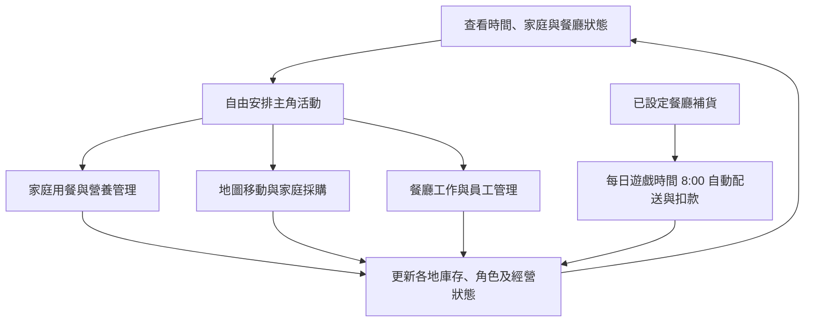
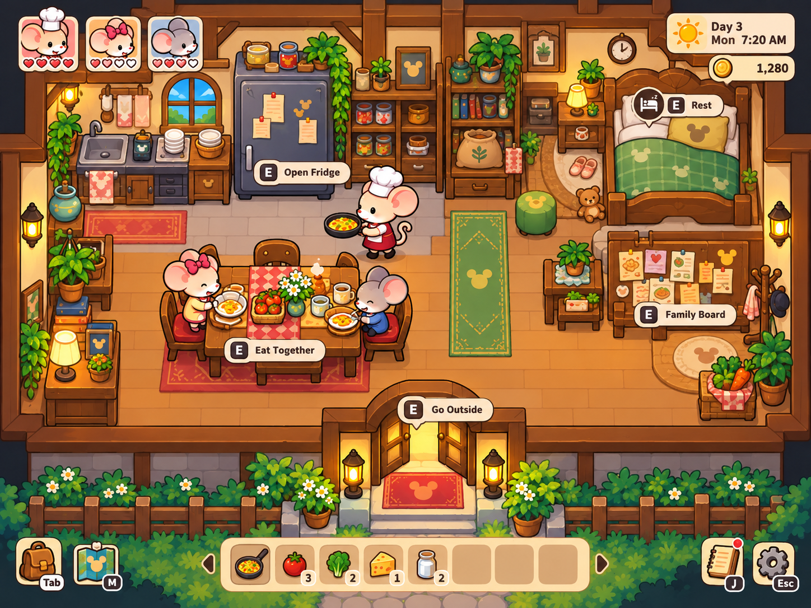
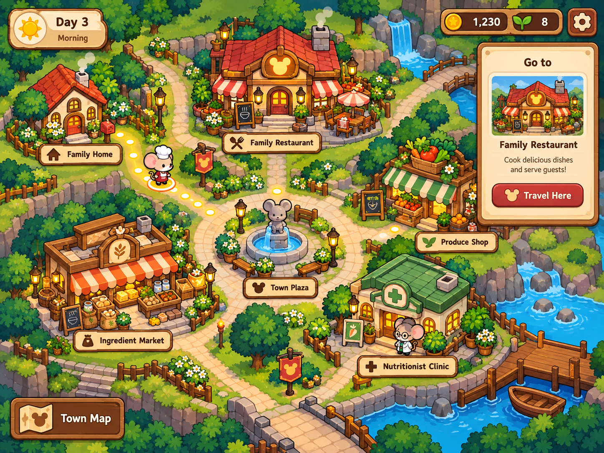
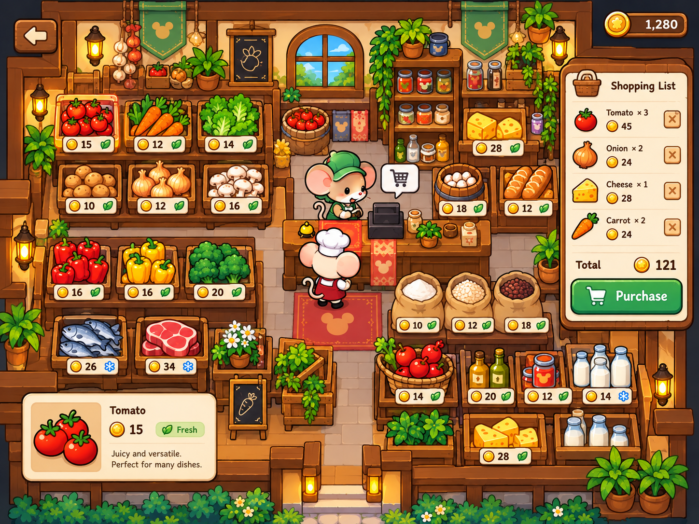
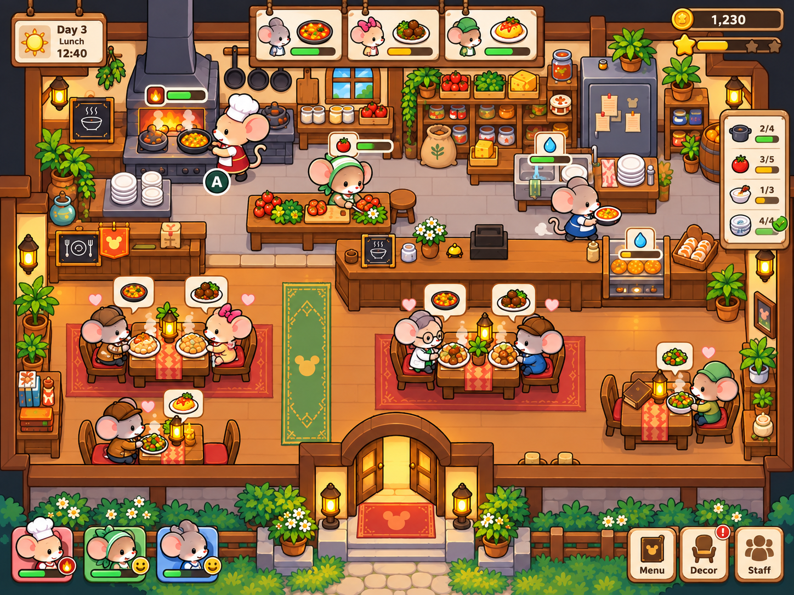

# 鼠於我的小餐館｜主要遊戲流程

| 項目         | 內容                                                                                                                             |
| ------------ | -------------------------------------------------------------------------------------------------------------------------------- |
| 正式專案名稱 | 鼠於我的小餐館 |
| 專案資料夾 | `ratatouille-os` |
| 文件版本     | V0.2                                                                                                                             |
| 文件狀態     | 已確認主要流程，細部規則待規劃                                                                                                   |
| 配套文件     | [專案需求規劃](01_專案需求規劃.md)、[專案功能與 OS 演算法映射](03_專案功能與OS演算法映射.md)、[遊戲畫面概念](04_遊戲畫面概念.md) |

## 1. 遊戲概念

玩家只直接控制主角，在家庭、餐廳與商店間自由安排活動，並在建築範圍內自由移動。家庭員工依工作表執行任務，主角透過管理面板安排工作。遊戲可持續經營，不設定固定結束天數。

家庭及餐廳庫存分開。家庭由主角到商店採購，餐廳則設定補貨後定時配送。營養不足的家庭員工無法工作，家庭飲食與餐廳人力因此連動。

> **圖片僅供理解遊戲流程，並非正式畫面規定。需完成畫面、操作、元件、資料及素材的正式規格化並確認後，才能套用於實作。圖中按鍵、數值、角色數量及入口均為概念示意。**

## 2. 每日活動與長期循環

### 2.1 時間與自由活動

遊戲 24 小時對應現實 20 分鐘，正常操作時時間持續流動。睡覺與地圖路程可跳過部分遊戲時間，因此完成一天不一定需等待完整 20 分鐘。

玩家自由決定上下班、開關店、回家及目的地，不必依固定日程行動。睡眠跳多久、路程如何計時，以及跳時期間的工作、配送與跨日狀態更新，仍待規劃。

圖中為活動與事件關係，不代表玩家必須依序執行。

### 2.2 長期經營循環

**現有資源 → 規劃工作與管理 → 執行並觀察成果 → 升級與自動化 → 資源條件改變 → 重新調整策略。**

升級貫穿進度，不限定在一天結束時進行。後期可加入不需食物營養、可工作更久的老鼠機器人；具體導入方式依遊戲最終規模規劃。升級路線及自動化能力尚未定案。

## 3. 查看狀態與安排活動

玩家查看時間、金錢、家庭營養、兩地庫存及餐廳工作情況，決定當下活動。家庭資源不足會產生親自採購需求；餐廳庫存及料理需求則影響補貨設定與工作安排。

最多五隻老鼠為目前規模限制，適用對象及是否包含機器人仍待明確。遊戲起始時間、初始資源及跨日細則待規劃。

對應需求：GAME-02～06、12、18～20。

## 4. 家庭生活：營養與工作能力連動

家庭以廚房、冰箱、餐桌及休息區呈現生活空間。角色在家庭場景用餐；圖中的共同用餐操作、看板及狀態圖示仍需規格化。

**查看家庭員工營養 → 取得料理營養屬性及飲食策略 → 檢查家庭食材 → 家庭用餐 → 依狀態安排工作。**

營養師提供食材製成料理後的屬性資訊，並自動規劃飲食策略。吃什麼、如何吃、策略評估標準、營養門檻及恢復方式待規劃；營養師是否為家庭固定 NPC 仍未確認。

家庭使用自身庫存，缺少食材時由主角到商店購買。每位家庭員工需管理營養，營養不足者無法工作，進而影響餐廳可用人力。不預設其他情緒或罷工事件。

對應需求：GAME-04、06、07、11、12、17、18。

## 5. 地圖、家庭採購與餐廳補貨

### 5.1 地圖與移動

主角自由選擇目的地，在家庭、餐廳與商店間移動；地圖路程可跳過相應遊戲時間，建築範圍內則自由移動。路程時間與其他成本待規劃。

商店類型為蔬菜店、肉舖、雜貨店，家庭與餐廳使用同一套地圖商店。圖中的營養師診所等建築不代表已確認的地圖配置。

### 5.2 家庭親自採購

**確認家庭需求與庫存 → 比較商店品項、價格、距離及優惠 → 主角前往購買 → 家庭庫存 → 飲食使用。**

概念圖的貨架、商品卡及購物清單用於說明選購過程，數量操作、優惠及入庫細節仍待規劃。

### 5.3 餐廳設定補貨

**查看餐廳需求與庫存 → 在補貨區設定內容 → 每日遊戲時間 8:00 自動配送到店並扣款 → 餐廳庫存 → 料理使用。**

餐廳以設定配送補貨，與主角為家庭親自購買分流。補貨設定、生效、扣款時點及資金／容量不足時的處理待規劃；不預設這些細則已有答案。

對應需求：GAME-08～12、19。

## 6. 儲存與食材管理

| 位置     | 補充來源               | 消耗用途           |
| -------- | ---------------------- | ------------------ |
| 家庭庫存 | 主角親自採購           | 家庭飲食與營養補充 |
| 餐廳庫存 | 已設定的每日 8:00 配送 | 餐廳料理與經營     |

兩地不直接共用庫存，是否允許轉移及具體方式仍待規劃。食材需管理數量與有效期限，可丟入垃圾桶；過期、容量與垃圾處理細則待規劃。

餐廳初始配置包含小冰箱。冷凍櫃與多層級倉庫仍為成長範例，未確定升級路線。餐盤不受空間限制僅為個人預設，尚未確認。

食材知識庫記錄食材性質，庫存則記錄各地點持有狀態。

對應需求：GAME-12、14、17、19。

## 7. 餐廳料理與經營

餐廳初始配置為小冰箱、烹飪台、灶台、流理臺及垃圾桶，另需有補貨區。概念圖以廚房、用餐區及中間櫃台呈現工作關係，實際配置待規格化。

### 7.1 顧客與收入

玩家自由決定營業時間。開店後顧客自動出現，即使半夜也會有顧客。系統自動計算收入，結算方式仍待規劃。

顧客如何點餐、座位與等候規則未定。「到櫃台點餐，主角看到待製作菜色」仍為個人預設。

### 7.2 最小餐點工作流程

1. 從冰箱／餐廳倉儲取得食材。
2. 將食材放置到烹飪台。
3. 與灶台互動，自動執行做菜。
4. 將完成餐點上菜至餐桌。
5. 收盤子並清洗餐盤。

自動做菜是互動後的製作步驟，不代表整體工作流程已自動化。每步由誰負責、耗時及並行方式待規劃。食材不足會影響製作與補貨設定，人員及設備競爭則形成工作安排問題。

對應需求：GAME-05、12、13、16、18、19。

## 8. 員工管理與可選 OS 策略

主角是唯一可直接操控的角色。家庭員工依工作表執行，主角透過管理面板安排其工作內容；營養不足的員工無法工作。工作表、排班、各步驟分工與任務中斷細節待規劃。

OS 管理為官方推薦的進階方向，玩家自己學會能力後可使用。等基本工作與管理問題成熟後，再規劃具體策略、切換及比較方式；不是強制玩法或已完成的核心技能。

系統內部互斥、同步等正確性機制與玩家可選策略分開。候選演算法見[映射文件](03_專案功能與OS演算法映射.md)，課程要求不因玩家選擇而取消。

對應需求：GAME-06、18、21、SYS-04。

## 9. 升級、自動化與機器人

升級會改變資源容量、工作限制或管理能力，使玩家重新評估策略，也是取得自動化的可能途徑之一。自動化讓部分原本需手動處理的工作由系統執行。

後期老鼠機器人為正式需求方向，可工作更久、不需食物營養；取得方式、工作能力及導入程度依最終規模規劃。

目前不建立固定升級樹，也不沿用草案的 LV2／LV3 作為正式等級。升級項目、上限、效果及自動化內容尚未確定。

對應需求：GAME-14、15、20、21。

## 10. 狀態延續與跨日

時間持續流動，家庭營養、各地庫存、料理工作與金錢等狀態隨活動更新並延續。睡眠與路程可跳時，跳時及跨日如何更新事件、工作及配送仍待設計。

遊戲不以固定結束天數收尾。初始狀態、存檔、重開與其他目標或失敗條件未定。

## 11. 連貫遊玩示例

以下為功能銜接示例，不限定每日順序：

1. 主角查看家庭營養及餐廳庫存，安排家庭飲食與工作表；營養不足者暫時無法工作。
2. 家庭缺料時，主角透過地圖前往商店採購。餐廳則透過補貨區設定內容，每日 8:00 自動配送並扣款。
3. 主角自由決定開店時間，顧客自然出現；點餐操作依後續規劃銜接。
4. 料理依取食材、放烹飪台、灶台互動、上菜、收洗餐盤的流程進行；主角用管理面板安排家人工作。
5. 系統計算收入，資源與角色狀態持續更新。主角可回家、睡覺或繼續活動。
6. 經營進度帶動後續升級、自動化與機器人發展，具體路線另行規劃；玩家可依後續設計選用 OS 策略。
