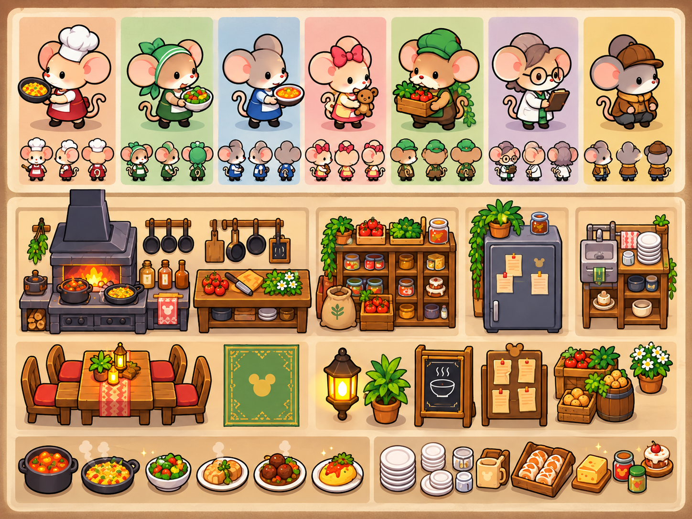
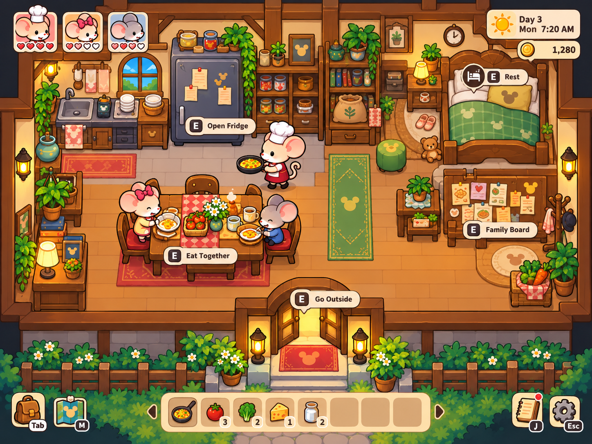
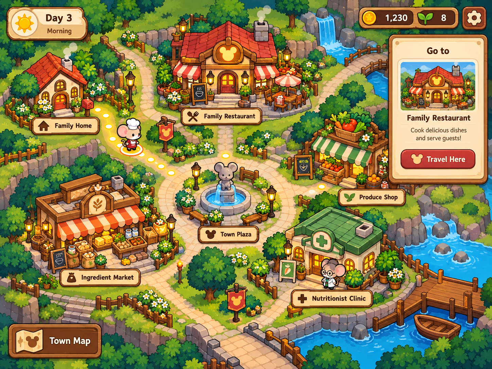
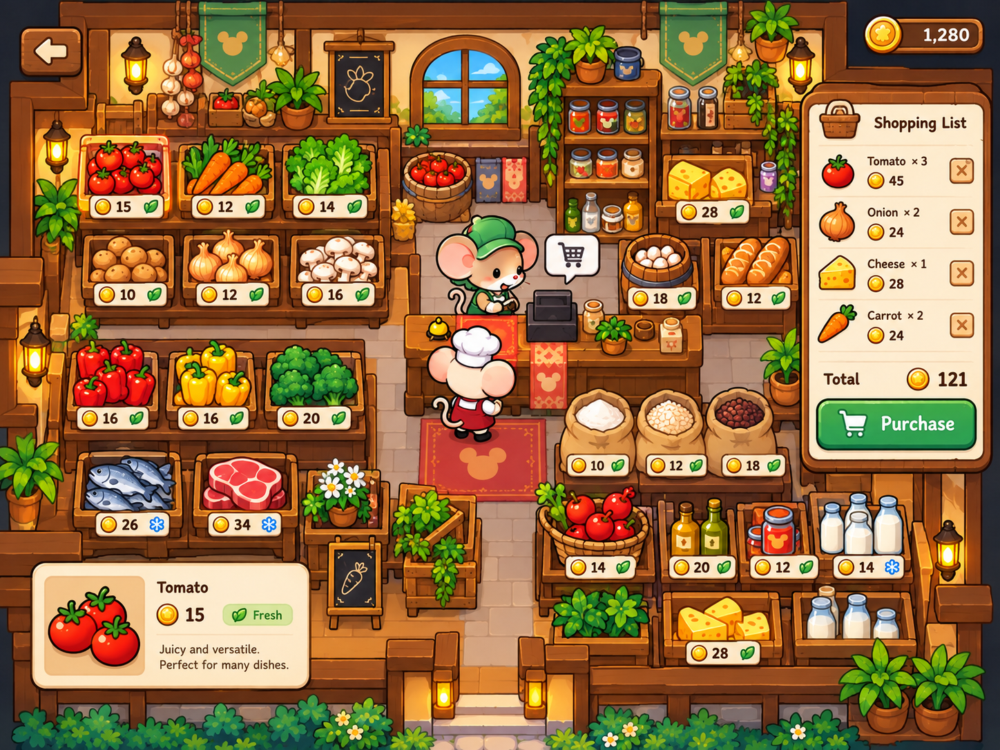
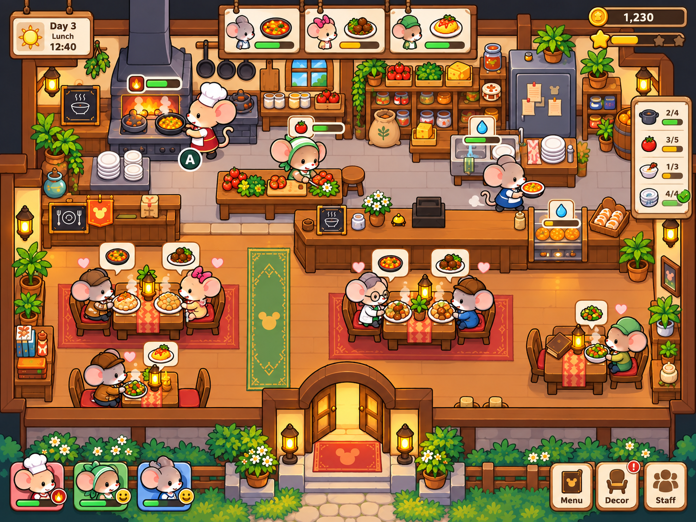

# 鼠於我的小餐館｜畫面概念

| 項目 | 內容 |
| --- | --- |
| 正式專案名稱 | 鼠於我的小餐館 |
| 專案資料夾 | `ratatouille-os` |
| 文件狀態 | 概念示意，尚未規格化，不作為正式實作規格 |
| 配套文件 | [專案需求規劃](01_專案需求規劃.md)、[主要遊戲流程](02_主要遊戲流程.md) |

> **目前畫面僅供構想展示與討論，並非正式規定或可直接套用的介面、素材及玩法規格。須先完成正式規格化，明確定義畫面配置、操作流程、元件狀態、資料欄位、素材尺寸與功能對應，經確認後才能套用於實作。圖中呈現的內容不代表已確定納入開發。**

## 1. 整體視覺

目前概念圖以可愛老鼠角色、暖色木質空間與斜俯視場景呈現。家庭、商店及餐廳以室內剖面呈現，地圖以小鎮全景連結各地點。角色、食材、家具及介面使用一致的圓潤造型與圖示。

畫面以場景為主，搭配時間、金錢、角色狀態與當前操作資訊。互動提示出現在相關物件附近，清單與詳細資訊放在畫面側邊。

角色、美術與世界觀由團隊原創，料理鼠王元素僅保留彩蛋致敬；彩蛋內容與對外展示方式確定時，需確認尚待處理的著作權與授權事項。既有美術方向仍參照這五張概念圖；畫面配置、互動及素材仍需正式規格化。圖中數值、角色數量、按鍵、圖示及選單為示意。

## 2. 角色與場景物件

| 分類 | 畫面內容 |
| --- | --- |
| 角色 | 七組不同服裝與外觀的老鼠角色，搭配正面、側面及背面造型 |
| 廚房設備 | 爐台、備料桌、食材架、冰箱與清洗區 |
| 室內家具 | 餐桌椅、地毯、燈具、盆栽、黑板及告示板 |
| 食材與餐點 | 蔬果、乳製品、麵包、罐裝食材，以及不同料理成品 |
| 餐具 | 餐盤、碗、杯子與容器 |

圖中七組角色是造型展示，不代表七名正式角色。目前老鼠數量限制為最多五隻，適用對象及是否包含機器人仍待明確。玩家僅直接操控主角，家庭員工依工作表執行；後期另有機器人方向。實際角色造型與各工作職責待規劃。

## 3. 家庭畫面

家庭畫面包含廚房、冰箱、餐桌、休息區、家庭看板及外出入口，將生活活動集中在同一場景。

| 區域 | 畫面表達 |
| --- | --- |
| 左上角色卡 | 角色頭像與愛心狀態，呈現不同成員的狀況 |
| 右上資訊 | 日期、時刻與持有金錢 |
| 冰箱與廚房 | 查看家庭食材及準備飲食的場景入口 |
| 餐桌 | 以共同用餐呈現飲食與營養補充 |
| 床鋪 | 休息互動概念 |
| 家庭看板 | 家庭相關資訊入口概念 |
| 房屋出口 | 外出並銜接小鎮地圖 |
| 底部工具列 | 背包、地圖、物品快捷欄、記事及設定入口 |

對應流程：查看狀態 → 檢查家庭食材 → 安排飲食 → 視需要外出採購或前往餐廳。

家庭用餐與每位家庭員工的營養管理已確認，營養不足者無法工作。營養師提供料理營養屬性及飲食策略，是否為家庭固定 NPC 尚未確認。圖中角色卡、用餐、休息與看板操作仍待規格化；家庭冰箱使用獨立家庭庫存。

對應需求：GAME-04、06、07、08、12、17、18。

## 4. 小鎮地圖

地圖以道路連結家庭、餐廳、食材市場、蔬果店、營養師診所與廣場。玩家位置與選定路線以角色及亮點呈現。

| 區域 | 畫面表達 |
| --- | --- |
| 地點建築與標牌 | 辨識各場所及其用途 |
| 角色與路徑亮點 | 表達目前位置及前往地點的路線 |
| 右側目的地卡 | 顯示選定地點的圖片、名稱、用途與前往按鈕 |
| 左上資訊 | 天數與時段 |
| 右上資訊 | 金錢、其他資源圖示及設定入口 |

對應流程：離開目前場景 → 查看地點 → 自由選擇目的地 → 前往家庭、商店或餐廳；地圖路程可跳時，場景建築內自由移動。

商店類型已確認為蔬菜店、肉舖、雜貨店，原圖中的市場、蔬果店與診所等僅為視覺概念，需依正式配置調整。營養師功能已確認，但不將診所當成必備建築。距離、移動成本、優惠及其他資源圖示仍待規格化。

對應需求：GAME-07～11。

## 5. 商店採購畫面

以貨架陳列商品，將食材選擇、商品資訊及購物清單放在同一畫面，讓玩家查看品項並確認採購內容。

| 區域 | 畫面表達 |
| --- | --- |
| 商品貨架 | 食材外觀、價格及狀態圖示 |
| 選中商品 | 以亮框標示目前查看的食材 |
| 左下商品卡 | 食材名稱、圖片、價格、狀態與簡介 |
| 右側購物清單 | 品項、數量、金額、移除按鈕及總價 |
| 購買按鈕 | 確認清單並進行採購 |
| 右上金錢 | 顯示可用資金 |
| 左上返回 | 離開商店畫面 |

對應家庭採購：查看食材 → 加入或調整清單 → 檢查數量及總價 → 確認購買 → 家庭庫存。

餐廳使用同一套地圖商店設定補貨，每日 8:00 自動配送到店並扣款。補貨區與設定畫面需另行規格化，不直接以圖中的家庭購物清單作為正式補貨介面。

數量調整、狀態圖示、優惠呈現與具體入庫操作待規劃。

對應需求：GAME-10～12、17、19。

## 6. 餐廳經營畫面

餐廳上半部為廚房與工作區，下半部為顧客用餐區，中間以出餐櫃台連結，呈現備料、料理及送餐之間的關係。

| 區域 | 畫面表達 |
| --- | --- |
| 頂部料理卡 | 角色、餐點及狀態條，呈現待處理或進行中的料理資訊 |
| 爐台、備料桌與清洗區 | 不同工作位置及進度提示 |
| 冰箱與食材架 | 餐廳儲存設備與取料位置 |
| 出餐櫃台 | 廚房與用餐區之間的交接位置 |
| 餐桌與顧客 | 透過餐點氣泡及愛心圖示表達用餐需求或回饋 |
| 右側清單 | 以物件圖示、數量與進度條呈現狀態 |
| 左下角色卡 | 工作角色及狀態概念 |
| 右下選單 | 菜單、裝飾及員工管理入口概念 |
| 頂部資訊 | 日期、時刻、金錢及星級圖示 |

已確認工作流程：冰箱取食材 → 放置烹飪台 → 與灶台互動自動做菜 → 上菜至餐桌 → 收盤與洗餐盤。

初始設備為小冰箱、烹飪台、灶台、流理臺與垃圾桶，另需呈現補貨區。正式畫面須銜接上述取料、放料、烹飪、上菜、收洗與食材丟棄的互動。

家族員工制度已確認，主角透過管理面板安排員工工作。開店後顧客自然出現，半夜也有顧客；系統自動計算收入。角色分工、點餐、結算、各狀態條、星級、右側清單及裝飾入口仍待規劃；櫃台點餐與餐盤無容量限制並非確定規則。

對應需求：GAME-05、12、13、16、18、19。

## 7. 畫面銜接

**家庭 ⇄ 小鎮地圖 ⇄ 商店／餐廳**

家庭：主角前往地圖商店採購 → 家庭庫存 → 家庭飲食與營養補充。

餐廳：補貨區設定 → 每日 8:00 自動配送及扣款 → 餐廳庫存 → 料理與經營。

兩地使用同一套地圖商店，但庫存及取得物資的流程分開。

目前概念圖已呈現生活、移動、採購及餐廳場景。獨立庫存的詳細操作、營養師介面、食譜查詢、升級、自動化與演算法策略介面仍待規劃。
