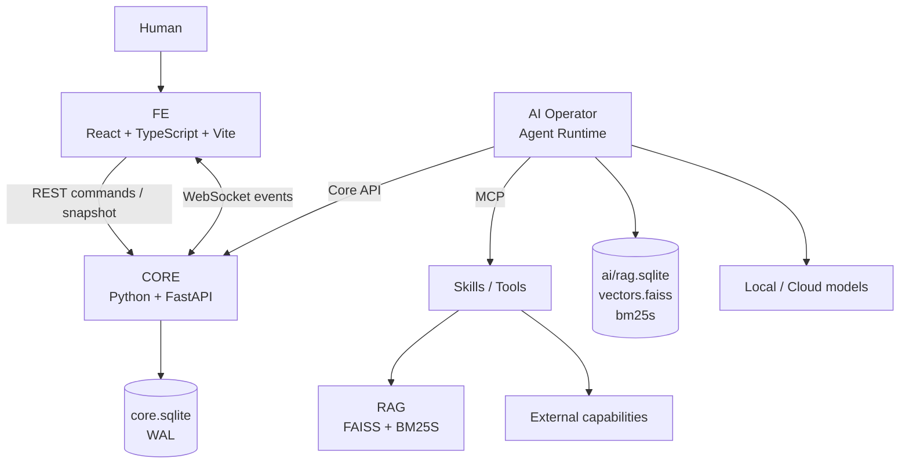
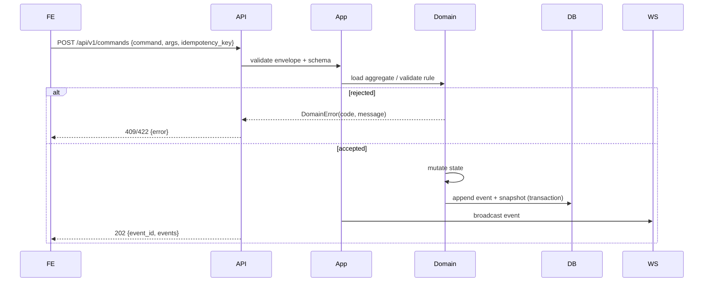

# 17｜系統架構與模組設計

| 項目 | 內容 |
|---|---|
| 文件版本 | V0.1 |
| 文件狀態 | 依 2026-10-31 專案負責人指示建立；企劃未定處以 **TBD** 標記，不視為已定案 |
| 適用範圍 | CORE／FE／AI 三服務、資料所有權、通訊協定、模組邊界、執行環境、測試策略 |
| 主要依據 | `01` 需求、`03` 演算法映射、`06` 設計政策、`08` 世界運作、課程 PDF |
| 配套文件 | `16` SRS（待補）、`18` 技術選型、`19` AI、`20` 資料模型、`21` OS 實作、`22` API、`23` 部署、`24` 測試 |

> **建立背景：** 課程要求先完成 RA／SA 再實作，而 `15～24` 原先只有標題（本文件為第一份補上的工程文件）。本文件先固定可由既有需求推導的結構；玩法數值、顧客公式、營養門檻、衛生機率等仍由 `09～12` 決定，不以架構文件代替企劃決策。

## 1. 架構目標與不可破壞條件

### 1.1 目標

1. **CORE 是唯一 authoritative world。** 所有世界狀態的裁決都在 CORE 完成。
2. **FE 與 AI 是兩種 operator。** 兩者都只能透過 Core API 讀寫世界，不得繞過 CORE。
3. **CORE 可獨立運作。** 關閉 FE、AI 後，CORE 仍可啟動、測試、存檔與重播。
4. **契約優先。** CORE、FE、AI 之間共享 OpenAPI／JSON Schema，不靠 Python import 耦合。
5. **先正確再優化。** 只有 profiler 證實的 Python CPU hotspot 才進入 Numba。
6. **基礎設施故意簡單。** 現階段不引入 Docker、Redis、Kafka、Celery、GraphQL、Kubernetes。

### 1.2 Invariant 與執行方式

| # | Invariant | 執行方式 |
|---|---|---|
| I1 | CORE 是唯一 authoritative world | 只有 CORE 進程持有 `core.sqlite` 寫入權；FE／AI 無 DB 憑證 |
| I2 | FE 不直接存取 DB | FE 依賴僅 HTTP／WS；`frontend/package.json` 不得出現 DB driver |
| I3 | AI 不直接存取 Core DB | AI 只設定 `CORE_API_BASE`；AI 進程不得載入 core DB 路徑 |
| I4 | FE／AI 都經 Core API 操作世界 | 所有 mutation 只能走 `POST /api/v1/commands` |
| I5 | CORE 不依賴 AI | CORE 的啟動、測試、CI 不 import `ai/` |
| I6 | CORE 不依賴 FE | CORE 的啟動、測試、CI 不 import `frontend/` |
| I7 | MCP 位於 Agent／Skills 邊界 | CORE API 不包成 MCP；MCP server 只暴露 Skill／tool |
| I8 | 只有 hotspot 用 Numba | 需附 profiler 證據與 reference／optimized 對照測試 |
| I9 | 先正確性再優化 | 每個優化版本必須先有 reference 實作與固定測資 |
| I10 | 不為看起來專業而增加基礎設施 | 新服務／中介軟體需在 ADR 記錄必要性與替代方案 |

**驗收方式：** `core/tests/test_architecture.py` 以 import graph 與檔案掃描檢查 I2、I3、I5、I6；CI 阻擋違規。這是低成本、可持續的架構測試，不需要額外框架。

## 2. 系統組成與責任邊界



**正式關係只有：** Human → FE → Core API；AI → Core API；AI → MCP Skills。AI 不經過 FE。

### 2.1 責任表

| 服務 | 必須負責 | 明確不負責 |
|---|---|---|
| **CORE** | 世界時間、狀態、遊戲規則、訂單／工作／庫存／經濟、OS 演算法、command 驗證、event log、存檔／讀檔、Core API／WS | React、DOM、LLM SDK、MCP tool 實作、embedding、FAISS 細節 |
| **FE** | 顯示 snapshot／event、送出 command、terminal／inspector／chart、9 頁課程功能、AI chat 入口、系統監控 | 遊戲結果裁決、authoritative state、直接 DB、演算法結果自行計算 |
| **AI** | Agent runtime、planner、tool router、MCP server／client、Skills、RAG、embedding、模型 adapter、routing、AI 執行紀錄 | 直接改 CORE DB、取代 CORE 裁決、把 Core API 改成 MCP |

### 2.2 依賴方向

```text
frontend  ──HTTP/WS──▶  core
ai        ──HTTP/WS──▶  core
ai        ──MCP──────▶  skills
core      ──X────────▶  frontend / ai      （禁止）
frontend  ──X────────▶  core DB            （禁止）
ai        ──X────────▶  core DB            （禁止）
```

`core` 只能依賴自己的 domain、simulation、algorithms、persistence、api；不得 import `ai` 或 `frontend`。

## 3. 執行環境與程序拓撲

| 服務 | 位址 | 啟動順序 | 必要條件 |
|---|---|---|---|
| CORE | `http://127.0.0.1:8001` | 1 | 可寫 `data/core/` |
| AI | `http://127.0.0.1:8002` | 2（可選） | CORE health 可用；模型／索引可選 |
| FE | `http://127.0.0.1:5173` | 3（可選） | CORE API 可用 |

- 三個服務各自是獨立進程；不以 Python import 串成單一進程。
- CORE 啟動時不得要求 AI 或 FE 存在；AI／FE 啟動時必須先檢查 CORE `/health`。
- 開發模式使用 `scripts/run_all.py` 一次拉起；單獨除錯時可只跑 CORE。
- 現階段不使用 Docker；`23` 只記錄未來容器化條件，不提前引入。

### 3.1 環境變數（草案）

| 變數 | 服務 | 用途 |
|---|---|---|
| `CORE_HOST` / `CORE_PORT` | CORE | 預設 `127.0.0.1:8001` |
| `CORE_DB_PATH` | CORE | 預設 `data/core/core.sqlite` |
| `CORE_API_BASE` | AI／FE | 預設 `http://127.0.0.1:8001` |
| `CORE_CORS_ORIGINS` | CORE | 開發時允許 `http://127.0.0.1:5173` |
| `AI_DB_PATH` / `AI_INDEX_DIR` | AI | `data/ai/` 下的 RAG 儲存 |
| `AI_LOCAL_MODEL` / `AI_CLOUD_MODEL` | AI | 模型識別碼；不提交金鑰 |
| `AI_CLOUD_API_KEY` | AI | 只從環境或本機 secret 讀取 |
| `SIM_SEED` | CORE | 固定隨機種子，供重現 |

## 4. Repository 結構

```text
ratatouille-os/
├─ core/
│  ├─ api/                 # FastAPI 組裝、routers、Pydantic schemas、WS hub、錯誤映射
│  ├─ domain/              # 實體、值物件、規則、command/event 定義
│  ├─ simulation/          # 時鐘、tick、排程器、系統、seed
│  ├─ algorithms/          # OS 演算法 reference + 選用 numba 實作
│  ├─ persistence/         # SQLite、migration、snapshot/event log、save/load
│  └─ tests/
├─ ai/
│  ├─ agent/               # runtime、planner、tool router
│  ├─ models/              # local/cloud adapters、routing
│  ├─ rag/                 # ingest、chunk、embed、FAISS、BM25S、RRF/MMR
│  ├─ mcp/                 # MCP server/client、tool registry
│  ├─ skills/              # 25+ Skills（每個含 SKILL.md 與程式）
│  ├─ core_client/         # 只經 Core API 的 client
│  └─ tests/
├─ frontend/
│  ├─ src/                 # shell、pages、components、api client、ws client
│  ├─ public/
│  └─ package.json
├─ data/
│  ├─ core/                # core.sqlite（不進 git）
│  └─ ai/                  # rag.sqlite、vectors.faiss、bm25s/
├─ docs/
├─ scripts/                # run_all.py、seed_db.py、generate_types.py
├─ .env.example
├─ .gitignore
└─ README.md
```

**與 `06` 建議結構的差異：** 未另建 `core/app/`；M1 由 `core/api/app.py` 同時負責 FastAPI 組裝與路由轉接，避免多一層空殼。其餘 `domain/simulation/algorithms/persistence/api/tests` 的分層是為了讓 domain 不依賴 FastAPI、algorithms 可獨立測試；這是 Clean-ish layering 的最小版本，不引入完整框架。

## 5. CORE 模組設計

### 5.1 分層與依賴規則

```text
api  ──▶ application（use cases）──▶ domain
 │                                  ▲
 └──▶ persistence / simulation ─────┘
```

- **domain**：純 Python；不得 import FastAPI、SQLite、NumPy、Numba。只放實體、值物件、規則、command/event dataclass。
- **application**：command handler、query handler、transaction 邊界；依賴 domain 與 port 介面。
- **simulation**：時間推進、tick、排程、事件套用；可依賴 domain 與 algorithms，不依賴 FastAPI。
- **algorithms**：純函式為主；輸入 task/resource 陣列，輸出 schedule/metrics/trace；不得讀 DB。
- **persistence**：實作 repository port；SQLite 連線、migration、event log、snapshot。
- **api**：Pydantic schema、router、WS、錯誤碼；只做轉接，不放業務規則。
- **api/app.py**：組裝、config、middleware、例外映射。

### 5.2 Command / Event 流程



- 所有 mutation 走同一條 command pipeline；玩家、AI、scheduler、test 共用。
- Command 必須有 `command` 名稱、`args`、`idempotency_key`；同一 key 重送不得重複套用。
- Event 是已發生事實，包含 `event_id`、`type`、`occurred_at`、`sim_time`、`payload`、`causation_id`、`correlation_id`。
- 不做完整 Event Sourcing；事件用於通知、審計與重播，snapshot 仍是主要讀取來源。

### 5.3 併發與一致性

- **單一寫入者**：CORE 內以一個 asyncio lock（或單一 simulation loop）序列化 command；避免多執行緒同時改世界。
- **SQLite WAL**：允許讀取與單寫入並行；`busy_timeout` 明確設定。
- **交易邊界**：`state mutation + event append + snapshot update` 在同一交易；失敗則全部回滾。
- **WS 廣播**：交易 commit 後才廣播，避免 FE 看到未持久化事件。
- **背壓**：WS 慢客戶端以有界 queue 處理；超過上限斷線並要求重連 snapshot，不阻塞世界。

### 5.4 時間與模擬

| 項目 | 決定 | 狀態 |
|---|---|---|
| 遊戲日 | 24 遊戲小時 = 20 現實分鐘 | 已確認（GAME-03） |
| Tick | 可設定；遠端分支 `08` 提議 20 Tick/s | **候選**，待 `08-01` 定案 |
| 暫停 | 管理操作暫停全世界 | 已確認方向；適用範圍 TBD |
| 跳時 | 睡眠／移動需結算工作、資源、事件 | 已確認方向；公式 TBD |
| 隨機 | 固定 seed，事件排序穩定 | 本文件要求 |
| 重播 | 同一 snapshot + 同一 command/seed → 同一結果 | 本文件要求 |

**設計要求：** 時間推進與「立即結算」共用同一套 simulation rules；不得用「效率 × 時間」取代庫存、人力、事件結算（`06` §5.3）。tick 頻率只影響取樣，不改變工作耗時的定義。

### 5.5 存檔／讀檔

- 自動存檔為主、手動存檔為輔（分支 `08` §3.5 方向）。
- 存檔單位是「世界 snapshot + 最後 event_id + schema_version」；不保存 Python object pickle。
- 讀檔時先驗證 schema_version，必要時 migration；缺欄位以預設值補齊並記錄。
- 不補算關閉期間的離線經營；重啟接續最近有效存檔。
- 每次存檔保留至少一個上一個有效版本，避免寫入中斷造成全毀。

## 6. API 契約

### 6.1 原則

- 前綴 `/api/v1`；破壞性變更才升版。
- JSON 使用 snake_case；時間用 `sim_time`（遊戲秒）與 `occurred_at`（UTC ISO-8601）分開。
- 所有 response 有 `request_id`；錯誤使用固定 `code`，不直接把 Python exception 丟給 FE。
- OpenAPI 是唯一契約來源；由 `scripts/generate_types.py` 產生 FE TypeScript types。
- 關閉 FastAPI 預設 `/docs` 的公開暴露（課程 PDF 對 FastAPI 的提醒）；內部可用 `ENABLE_DOCS=1` 開啟。

### 6.2 端點草案

| Method | Path | 用途 |
|---|---|---|
| GET | `/health` | CORE 自身健康；不檢查 AI／FE |
| GET | `/api/v1/meta` | 版本、schema_version、algorithm registry、feature flags |
| GET | `/api/v1/snapshot` | 當前世界 snapshot（支援 `?since_event_id=` 增量） |
| GET | `/api/v1/events` | 事件查詢（分頁、type、時間範圍） |
| POST | `/api/v1/commands` | 唯一 mutation 入口 |
| GET | `/api/v1/tasks` | 任務／佇列查詢（供排程頁） |
| GET | `/api/v1/resources` | 資源快照（供監控頁） |
| POST | `/api/v1/save` | 手動存檔 |
| POST | `/api/v1/load` | 讀取指定存檔 |
| WS | `/ws/events` | 世界事件、任務、資源、log 增量 |

**9 頁需要但尚未定案的查詢端點**（由 `22` 細化）：知識庫搜尋、來源清單、匯入 job、評估指標、食材比較、食安查詢、快取狀態、檔案／權限。這些 endpoint 屬於 CORE 或 AI，需在 `22` 明確 owner；FE 不直接查 AI DB。

### 6.3 Command 信封

```json
{
  "command": "ASSIGN_WORKER",
  "args": {"worker_id": 2, "station_id": 4},
  "idempotency_key": "fe-7f3c1a2e",
  "client": "fe"
}
```

回應：

```json
{
  "request_id": "req-...",
  "accepted": true,
  "event_ids": [1831],
  "state_version": 412
}
```

錯誤：

```json
{
  "request_id": "req-...",
  "accepted": false,
  "error": {"code": "WORKER_NOT_AVAILABLE", "message": "Worker 2 is not available", "details": {}}
}
```

### 6.4 WebSocket 信封

```json
{
  "event_id": 1831,
  "type": "WORKER_ASSIGNED",
  "sim_time": 312.4,
  "state_version": 412,
  "payload": {"worker_id": 2, "station_id": 4},
  "causation_id": "cmd-...",
  "correlation_id": "order-183"
}
```

- 連線後先送 `SNAPSHOT` 或要求 client 先 `GET /snapshot`，再從 `last_event_id` 補事件。
- 事件順序以 `event_id` 為準；client 必須能處理重複與缺口。
- 不每幀重傳整個 world；snapshot + incremental events 是唯一模式。

### 6.5 契約同步

```text
core Pydantic models
  → OpenAPI (FastAPI)
  → scripts/generate_types.py
  → frontend/src/api/schema.d.ts
  → ai/core_client（可另生成 Python client）
```

CI 檢查 generated types 是否與 OpenAPI 一致；不一致即失敗。禁止手改 generated 檔。

## 7. 資料所有權與儲存

### 7.1 邊界

| 儲存 | 擁有者 | 內容 | 誰可寫 |
|---|---|---|---|
| `data/core/core.sqlite` | CORE | 世界、實體、任務、事件、存檔、設定 | 只有 CORE |
| `data/ai/rag.sqlite` | AI | 文件、chunk、來源、citation、ingest job、agent run、model/tool call | 只有 AI |
| `data/ai/vectors.faiss` | AI | 向量索引 | 只有 AI |
| `data/ai/bm25s/` | AI | 關鍵字索引 | 只有 AI |

**禁止：** CORE／AI 共用同一顆 SQLite；AI 對 `core.sqlite` 開連線；FE 出現任何 DB 路徑。

### 7.2 Core schema（草案，`20` 細化）

| Table | 用途 |
|---|---|
| `world` | 單列世界 metadata：sim_time、day、seed、state_version |
| `entities` | 玩家、員工、顧客、設備、餐廳、商店等聚合的 JSON snapshot + 索引欄位 |
| `tasks` | 任務／工作佇列：狀態、優先權、arrival、burst、remaining、resource |
| `inventory` | 家庭／餐廳庫存、期限、數量 |
| `orders` | 訂單、顧客、狀態、金額 |
| `events` | append-only event log：id、type、sim_time、payload、causation |
| `saves` | 存檔 metadata：version、created_at、event_id、checksum |
| `settings` | 系統／遊戲設定 |
| `schema_migrations` | migration 版本 |

- 大型／可變聚合用 JSON payload，常用查詢欄位（status、owner、time）另外建索引；不一開始就正規化到數十張表。
- 金額用整數（分）或 Decimal 字串，不用 float。
- 時間用整數 tick 或毫秒，不用 float 累加。

### 7.3 AI schema（草案，`19`／`20` 細化）

| Table | 用途 |
|---|---|
| `documents` | 來源、標題、版本、授權、更新日、hash |
| `chunks` | 文件切片、text、position、metadata |
| `citations` | 回答與 chunk 的對應、引用片段 |
| `ingest_jobs` | 匯入 job 狀態、進度、錯誤 |
| `agent_runs` | agent 任務、計畫、狀態、耗時 |
| `model_calls` | provider、model、prompt tokens、latency、cost |
| `tool_calls` | MCP tool、args hash、result summary、latency |
| `evaluations` | 檢索命中率、回答品質、錯誤案例 |

- 向量不放一般 SQLite table；FAISS 存 index，rag.sqlite 存 id／metadata／text。
- BM25S 索引放 `data/ai/bm25s/`，與 FAISS 同一版本號。
- 文件與索引需記錄 `embedding_model` 與 `index_version`，避免換模型後混用。

## 8. Simulation 與 OS 演算法層

### 8.1 分離原則

- **演算法**是方法：FCFS、SJF、LRU、Banker's…。
- **Skill** 是可執行能力：`schedule_tasks`、`cache_request`、`check_access`…。
- 一個 Skill 可以呼叫多個演算法；一個演算法可被多個 Skill 使用。**不要求一對一。**
- 演算法不得直接讀寫 DB；由 application 載入資料、呼叫純函式、寫回結果。

### 8.2 介面草案

```python
@dataclass(frozen=True)
class Task:
    id: str
    arrival: int
    burst: int
    priority: int = 0
    remaining: int | None = None
    resources: dict[str, int] = field(default_factory=dict)

@dataclass(frozen=True)
class ScheduleResult:
    order: list[str]
    start: dict[str, int]
    finish: dict[str, int]
    waiting: dict[str, int]
    turnaround: dict[str, int]
    trace: list[TraceStep]
    metrics: dict[str, float]
```

- `trace` 供 FE 過程區逐步顯示 Skill／演算法／套件／輸入輸出。
- 每個演算法需有 `reference` 與可選 `numba` 版本；對外 registry 以名稱查詢。
- 固定 workload 以 JSON 放在 `core/tests/fixtures/`；reference 與 numba 結果必須一致。

### 8.3 12 個演算法候選與計數

| 類別 | 候選 | 備註 |
|---|---|---|
| 排程 | FCFS、SJF、SRTF、Priority+Aging、RR、MLFQ | MLFQ 為延伸；重複使用不重複計數 |
| 同步 | Mutex、Semaphore、Producer–Consumer | 需真實競爭與保護對象 |
| 死結 | Banker's、Deadlock Detection | 需 Available／Allocation／Need 或 wait-for graph |
| 記憶體／快取 | FIFO、LRU、OPT | OPT 作離線基準 |
| 磁碟／路線 | SSTF、SCAN、LOOK | 地圖應用需標示為模型應用 |
| 存取 | ACL | 計數口徑待確認 |

**現狀：** 尚未形成正式 12 項清單；本表只承接 `03` 候選。正式清單、計數口徑、Skill 對應由 `21` 定案，不能把候選數直接當成已達成。

### 8.4 Numba 邊界

- 適合：固定長度陣列、大量重複迴圈、batch simulation、Monte Carlo、排程 metrics。
- 不適合：FastAPI、JSON、DB、LLM、MCP、複雜 object graph。
- 使用 `@njit(cache=True)`；只有 profiler 證明可平行才用 `parallel=True`。
- Numba 不可用時，registry 自動 fallback 到 reference；測試需覆蓋 fallback。
- 每個 numba 版本需有 `reference == optimized` 的固定測資；容差與比較方式寫入 `21`。

## 9. AI 服務

### 9.1 元件

```text
ai/
├─ agent/        runtime loop、planner、tool router、memory（可選）
├─ models/       local adapter（LM Studio）、cloud adapter、router
├─ rag/          ingest、clean、chunk、embed、FAISS、BM25S、RRF、MMR
├─ mcp/          server、client、tool registry、SKILL.md loader
├─ skills/       25+ executable skills
└─ core_client/  只經 Core API 的 client
```

### 9.2 Agent 與世界

1. 訂閱 CORE `/ws/events` 或輪詢 snapshot。
2. 發現問題（例如 `ORDER_QUEUE_OVERLOAD`）。
3. 查詢更多 state（GET）。
4. 選擇 skill／model。
5. 提出 command（POST）。
6. CORE 驗證；拒絕時記錄原因，不重試到無限。

Agent 不持有 GameState object，不直接修改 CORE 記憶體或 DB。

### 9.3 MCP 邊界

- MCP server 暴露 Skills／tools，例如 `nutrition.compare`、`food_law.lookup`、`rag.search`、`os.schedule`。
- CORE API **不**包成 MCP；Agent 直接用 REST 呼叫 CORE。
- 每個 Skill 需有 `SKILL.md`（name、description、purpose、input、output、limits、steps）與可執行實作。
- Tool call 需記錄：tool name、args hash、start/end、status、result summary；報告時可證明「MCP 實際執行」。

### 9.4 RAG

```text
document → parse → clean → chunk → embedding → FAISS
                              └→ text → BM25S
FAISS + BM25S → RRF → MMR → context → LLM → answer + citations
```

- 查無資料時必須回答「目前知識庫沒有足夠證據」，不得編造。
- 回答需帶來源（document、chunk、version、URL／檔案）。
- 文件需記錄授權與更新日；個資欄位先移除。

### 9.5 地端／雲端 routing

Routing 決策需記錄：

| 欄位 | 說明 |
|---|---|
| `task_id` / `priority` | 工作識別與優先權 |
| `resource_snapshot` | CPU、GPU、RAM、I/O、佇列長度 |
| `policy` | 使用的排程／門檻規則 |
| `decision` | `local` / `cloud` / `reject` |
| `reason` | 人類可讀理由 |
| `model` | 實際模型 |
| `latency_ms` / `cost` | 執行結果 |
| `fallback` | 失敗時是否改路由 |

不可只寫 `if local_available: local() else: cloud()`；理由與資源快照必須可展示。

## 10. FE 設計

### 10.1 Shell

- 高資訊密度 terminal／control station，不使用大型 SaaS 卡片版面。
- 固定 shell：頂部狀態列（CORE／AI／MCP／LOCAL／CLOUD）、左側任務／資源、中央 main、底部快捷鍵。
- 共用元件：Table、LogStream、MetricBar、Inspector、CommandPalette、Chart、StatusDot。
- 圖表用 Chart.js；需要時才加 SVG／Canvas。現階段不引入 Godot／Unity／Phaser。

### 10.2 路由與 9 頁

| # | Route（草案） | 頁面用途 | 主要資料來源 |
|---|---|---|---|
| 1 | `/search` | 搜尋與問答、來源引用、查無資料 | AI RAG（經 CORE 或 AI API，`22` 定案） |
| 2 | `/sources` | 資料來源、授權、更新日、內容 | AI metadata |
| 3 | `/ingest` | 匯入、清理、切片、去重、進度 | AI ingest job |
| 4 | `/ops` | 新鮮度、版本、命中率、錯誤案例 | AI evaluation + CORE |
| 5 | `/os/tasks` | 任務佇列、優先權、等待、資源、AI 分派 | CORE |
| 6 | `/os/cache` | 快取內容、命中率、置換 | CORE |
| 7 | `/os/files` | 檔案配置、讀取順序、權限 | CORE |
| 8 | `/food/nutrition` | 食材營養比較、替代、食譜 | AI RAG + CORE |
| 9 | `/food/safety` | 添加物、抽驗、法規 | AI RAG + CORE |
| + | `/game` | 主要 simulation／terminal | CORE |

- 頁面顯示名稱要用主題語言，不直接把演算法名稱當頁名；演算法只出現在過程區標籤與頁尾「用什麼算」。
- 每頁（使用 Skill／演算法者）必須有：操作區 → 過程區 → 結果區 → 統計圖。
- 過程區每一步分開標示 **Skill** 與 **演算法／套件**，兩者不是同一個東西。

### 10.3 FE 狀態

- 只保存 UI state：selected worker、open panel、zoom、filter、sort、command history。
- Authoritative state 只存在 CORE；FE 以 snapshot + WS 重建。
- 重新整理後：`GET /snapshot` → 重建 UI；不從 localStorage 還原遊戲狀態。
- 禁止 `money -= 100`、`worker.state = "COOKING"` 這類本地裁決。

## 11. 跨領域機制

### 11.1 設定與秘密

- `.env.example` 只放 key 名稱與範例，不放真實金鑰。
- 雲端金鑰只從環境或本機 secret 讀取；log 需遮罩。
- 課堂展示前檢查截圖與 log 不含帳號、金鑰、個資。

### 11.2 日誌與可觀測性

- 結構化 JSON log；至少 `request_id`、`event_id`、`agent_run_id`、`tool_call_id`。
- CORE 記錄 command 拒絕原因；AI 記錄 routing 與 tool call；FE 記錄 API 錯誤。
- 不在 production log 放完整 prompt／個資；必要時只放 hash。

### 11.3 錯誤處理

| 類型 | HTTP | 例子 |
|---|---|---|
| 輸入格式 | 422 | schema 驗證失敗 |
| 業務規則 | 409 | worker 不可用、庫存不足 |
| 找不到 | 404 | task／save 不存在 |
| 未預期 | 500 | 不回傳 traceback 給 client |

FE 依 `error.code` 顯示可操作訊息；AI 依 `code` 決定是否重試或改路由。

### 11.4 效能

- 先量測再優化；profiler 證據納入 PR／報告。
- CORE 的 tick 預算需固定（例如每 tick < 5 ms，依硬體調整）；超過則記錄。
- 大批量模擬用 Numba；API／DB／JSON 不進 Numba。
- FE 不每幀重繪整個 world；以事件更新局部元件。

## 12. 測試與驗收

| 層級 | 內容 | 工具 |
|---|---|---|
| Unit | domain 規則、command 驗證、演算法 | pytest |
| Algorithm | 固定 workload、reference vs numba、邊界 | pytest + fixtures |
| Persistence | migration、WAL、存檔／讀檔、崩潰恢復 | pytest + tmp DB |
| API | schema、錯誤碼、idempotency | pytest + httpx/TestClient |
| WS | 順序、重連、缺口補償 | pytest + async client |
| Determinism | 同 seed／同 command → 同事件序列 | pytest |
| Contract | OpenAPI ↔ TS types 一致 | script + CI |
| Architecture | import graph、DB 邊界 | pytest / script |
| Integration | CORE + AI mock、CORE + FE mock | pytest / Playwright（後期） |
| E2E | 9 頁主要操作 | Playwright（後期） |

### 12.1 M1 驗收（建議）

1. `python scripts/run_core.py` 可在沒有 FE／AI 時啟動。
2. `GET /health`、`GET /api/v1/snapshot` 可用。
3. `POST /api/v1/commands` 可建立／完成一個任務，並產生 event。
4. WS 可收到同一 event；重連後可補齊。
5. 固定 seed 重跑兩次，事件序列一致。
6. 至少 3 個排程演算法（FCFS／SJF／RR）通過固定測資。
7. `pytest` 全綠；架構測試證明 CORE 未 import AI／FE。

> M1 只證明「世界核心 + 契約 + 演算法」可運作，不代表餐廳玩法或 9 頁已完成。

> **2026-10-31 實作進度：** M1 已建立 `core/` walking skeleton，24 個 pytest 通過；啟動與 API 範例見 `README.md`。M1 的 task 是通用工作單位，尚未接上餐廳訂單模型。

## 13. 部署與開發

- 開發：三個進程，無 Docker；`scripts/run_all.py` 負責啟動、健康檢查、日誌集中。
- 資料：`data/core/`、`data/ai/` 不進 git；提供 `scripts/reset_dev_data.py`。
- 建置：FE `npm run build`；CORE／AI 以 `pyproject.toml` + venv。
- 未來 Docker 化條件：需要多機部署、環境不一致、或課程要求；現階段不提前處理 networking。
- 展示：以本機 `127.0.0.1` 操作；報告前先跑 `scripts/preflight.py`（健康、資料、金鑰遮罩）。

## 14. 架構決策紀錄（ADR）

| # | 決策 | 理由 | 替代方案 | 代價／限制 | 狀態 |
|---|---|---|---|---|---|
| A1 | CORE 為唯一 authoritative world | 避免 FE／AI 各自裁決造成狀態分裂 | FE 本地模擬、AI 直接改 DB | CORE 成瓶頸；需清楚 API | 已定案 |
| A2 | 三服務 CORE／FE／AI | 責任邊界清楚，可獨立測試與替換模型 | 單體 FastAPI + React | 跨進程契約成本 | 已定案 |
| A3 | REST + WebSocket | 命令／查詢用 REST，增量事件用 WS | GraphQL、gRPC、純輪詢 | 需處理重連與順序 | 已定案 |
| A4 | SQLite + WAL | 單機、零維運、足夠課程規模 | PostgreSQL、DuckDB | 單寫入者；不適合多機 | 已定案 |
| A5 | Python + Numba | 生態、FastAPI、演算法教學；hotspot 加速 | 全 C++、Rust | Numba 子集限制；需 reference 對照 | 已定案 |
| A6 | React + TS + Vite | 終端 UI、型別契約、生態 | NiceGUI、Svelte | 需 build 與型別生成 | 已定案 |
| A7 | 不用 Godot／Unity | 不是完整遊戲引擎需求；Web 終端優先 | 2D 引擎 | 後期大量 sprite 才重新評估 PixiJS | 已定案 |
| A8 | 現階段不用 Docker | 降低環境複雜度 | docker-compose | 部署一致性較弱 | 已定案 |
| A9 | MCP 只在 Agent／Skills 邊界 | 避免把 Core API 強改成 MCP | 全部 MCP | 需另外維護 tool schema | 已定案 |
| A10 | FAISS + BM25S + RRF + MMR | 混合檢索、可解釋、符合課程 | 單一向量檢索、商用 reranker | 需維護兩套索引 | 已定案 |
| A11 | 不做完整 Event Sourcing | 課程規模不需要；snapshot 較簡單 | event-sourced aggregate | 重播能力有限 | 本文件提案 |
| A12 | API 版號 `/api/v1` | 契約穩定、FE／AI 可同步 | 無版號 | 需維護相容性 | 本文件提案 |

## 15. 未定事項與衝突

| # | 事項 | 影響 | 負責／來源 |
|---|---|---|---|
| U1 | 顧客生成、訂單→工作拆解、工作耗時、營養門檻、衛生／評論公式 | CORE 無法完成玩法實作 | `09～12` |
| U2 | 12 個演算法正式清單與計數口徑 | 課程 SYS-04 驗收 | `21`、`03` |
| U3 | 25 個 Skill 清單與 SKILL.md | 課程 SYS-05 | `19`、`21` |
| U4 | 9 頁的正式頁名、欄位、操作流程 | SYS-09／10 | `13`、`16`、`22` |
| U5 | 8:00 配送與玩家補貨的適用階段 | `01`／`02`／`06`／`10`／`11` 既有衝突 | 需求負責人 |
| U6 | 餐廳評論知識庫與遊戲隱性評論的關係 | SYS-01 餐飲知識庫範圍 | `11`、`16` |
| U7 | Tick rate、暫停範圍、跳時結算 | 模擬正確性與效能 | `08-01`／`08-02` |
| U8 | Python 3.14.10 + Numba／LLVM 實測 | 效能路線 | `18`、`24` |
| U9 | 遠端分支 `docs/publish-08-11` 未合併 | 文件版本分歧 | 團隊 |

**處理原則：** 未定事項不阻塞架構骨架；但不得在程式內寫死未定數值。先以設定／fixture 表達，待企劃定案後替換。

## 16. 課程要求對照

| 課程要求 | 架構承接 | 證據 |
|---|---|---|
| SYS-01 知識庫 | AI RAG + `documents/chunks/citations` | 來源頁、citation |
| SYS-02 資料處理 | ingest pipeline、chunk、dedup、job | 匯入頁進度與結果 |
| SYS-03 查詢問答 | RAG + 拒答 + citation | 問答頁 |
| SYS-04 12 演算法 | `core/algorithms/` + registry + trace | 對照表、固定測資 |
| SYS-05 25 Skills | `ai/skills/` + SKILL.md + MCP | Skill 清單、tool call log |
| SYS-06 MCP | MCP server/client | 實際 tool 執行紀錄 |
| SYS-07 雙環境 AI | local/cloud adapters | 兩種執行結果 |
| SYS-08 工作分派 | routing log + resource snapshot | 分派紀錄頁 |
| SYS-09 9 頁 | FE routes + shell | 現場操作 |
| SYS-10 操作/過程/結果/圖 | 共用頁面模板 + trace | 每頁四區塊 |
| SYS-11 四層架構 | FE／CORE／DB／AI | 本文件 |
| SYS-12 資料與授權 | 來源、版本、授權、去識別化 | 來源頁 |
| SYS-13 RA | `16` + 使用者故事 | 報告 |
| SYS-14 SA | 本文件 + `20`／`22` | 報告 |
| SYS-15 測試 | `24` + pytest | 測試紀錄 |
| SYS-16 成果 | 25+ 投影片、5 問 | 報告 |

## 17. 下一步

1. `20`：把第 7 節落實為 ERD、欄位、索引、migration。
2. `22`：把第 6 節落實為完整 OpenAPI／錯誤碼／9 頁 endpoint。
3. `21`：定案 12 演算法、Skill 對應、固定測資、reference／numba 對照。
4. `16`：把 SYS／GAME 轉成可驗收的 SRS，標明 TBD。
5. （M1 已完成）`core/` walking skeleton 已通過第 12.1 節驗收；下一步接上餐廳 domain。

> 本文件只固定結構與契約方向；玩法數值與未定規則仍以 `09～13` 為準。
