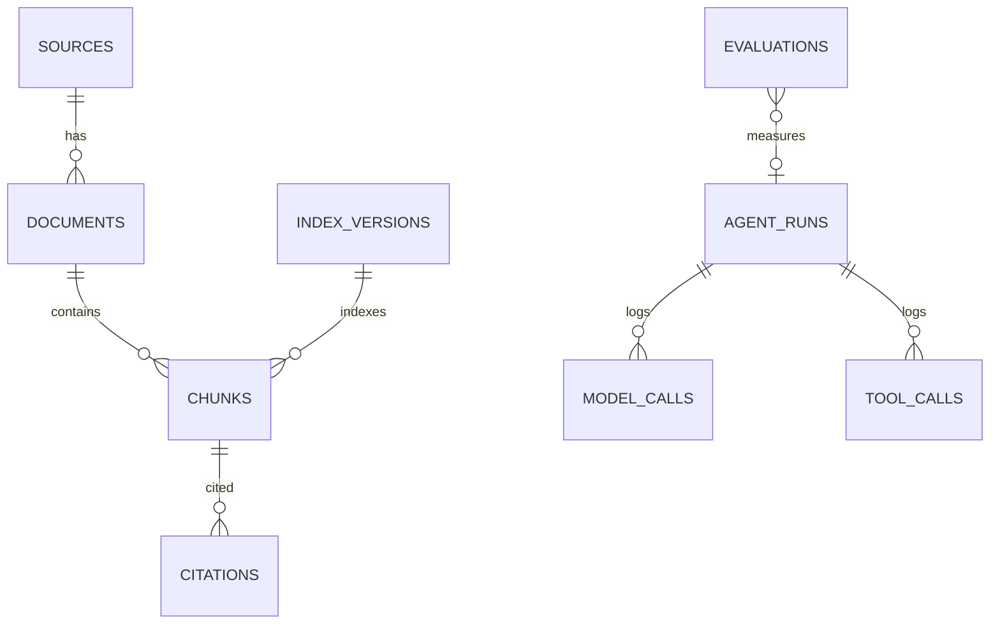

# 20｜資料模型與資料庫設計

| 項目 | 內容 |
|---|---|
| 文件版本 | V0.1 |
| 文件狀態 | 依 2026-10-31 負責人指示建立；CORE 與 AI **分庫**已落地，CORE schema 已到 v2（含 `saves`），部分 CORE 正規化表仍待 M2 |
| 適用範圍 | 遊戲／世界 DB、AI／RAG DB、索引檔、識別碼、版本、migration、備份 |
| 主要依據 | `11`、`17`、`18`、`18-01`、`08-04`、課程 PDF |
| 實作位置 | `core/persistence/store.py`、`ai/db.py`、`ai/tests/test_db.py`、`core/tests/test_db_ownership.py` |

## 1. 分庫原則

本專案有兩個 **不同擁有者、不同檔案** 的 SQLite：

| DB | 檔案 | 擁有者 | 內容 |
|---|---|---|---|
| 遊戲／世界 DB | `data/core/core.sqlite` | CORE | 世界時間、event log、snapshot、idempotency、存檔，未來的任務／庫存／訂單 |
| AI／RAG DB | `data/ai/rag.sqlite` | AI | 文件、chunk、citation、ingest、agent／model／tool 紀錄、評估、索引版本 |

**硬規則：**

1. 兩個 DB 不共用同一個 SQLite 檔。
2. 不做跨 DB 的 `JOIN`、`ATTACH DATABASE` 或跨服務 transaction。
3. AI 不直接讀寫 `core.sqlite`；需要世界狀態時呼叫 Core API。
4. AI 若需要保留 CORE 的識別碼（例如 `order_id`、`worker_id`），只存成 **opaque reference**，不建跨庫 foreign key。
5. CORE 不讀 `rag.sqlite`；CORE 的啟動與測試不需要 AI DB。
6. AI DB 可重建（文件重新 ingest、索引重建）；CORE DB 不可用 AI 資料重建。

> 這樣做的代價是「回答要引用遊戲狀態」時需要多一次 Core API 查詢；好處是 AI 的索引損壞、模型更換或 re-index 不會影響存檔與遊戲正確性。

## 2. 實體檔與索引

```text
data/
├─ core/
│  └─ core.sqlite          # 遊戲／世界，唯一 authoritative
└─ ai/
   ├─ rag.sqlite           # AI metadata / text / citations / logs
   ├─ vectors.faiss        # FAISS index（未來）
   └─ bm25s/               # BM25S index（未來）
```

- `rag.sqlite` 只存 chunk 的 **文字與 metadata**；向量本體在 FAISS，不在 SQLite table。
- FAISS 與 BM25S 的版本、embedding model、路徑記在 `index_versions`。
- 三個索引產物要同版本；換 embedding model 時重建，不混用。

## 3. CORE／遊戲 DB 現況

目前 `core/persistence/store.py` 實際建立的表（`schema_version=2`）：

| Table | 用途 | 主要欄位 |
|---|---|---|
| `meta` | DB metadata | `key`, `value`（`schema_version=2`） |
| `events` | append-only 事件 | `id`, `type`, `sim_time`, `state_version`, `payload`, `causation_id`, `correlation_id`, `created_at` |
| `snapshots` | 世界快照 | `id`, `state_version`, `last_event_id`, `state_json`, `created_at` |
| `idempotency` | command 去重 | `key`, `response_json`, `created_at` |
| `saves` | 手動存檔點 | `id`, `schema_version`, `state_version`, `last_event_id`, `label`, `state_json`, `checksum`, `created_at` |

索引：`idx_events_type`（event type 篩選）、`idx_events_sim_time`（時間範圍查詢）。

- `saves.checksum` 是 `state_json` 的 SHA-256；讀檔前驗證，不符回 409 `SAVE_CORRUPTED`。
- 存檔只增不減；不提供玩家刪除或歷史回溯選單（`08-04`）。
- 連線策略：**一條釘住的連線**（`check_same_thread=False` 加上執行緒鎖），PRAGMA 只在建立連線時設定一次。每個 command 開新連線會重付 WAL 附加成本，實測讓 p50 從 2.2 ms 退到 11.5 ms（見 `24`）。
- `snapshots` 仍保留「每個 command 寫一份」，這是為了 crash 復原；`saves` 是玩家進度，兩者用途不同。

**目前世界狀態的實體（Task／Worker／Station）存在 `snapshots.state_json` 裡，尚未正規化成獨立表。** 這是 M1 的刻意取捨：先確保 command／event／snapshot 的正確性，等 `11` 的工作模型穩定後再拆表。

M2 預定新增（尚未實作，不在本文件宣稱已完成）：

| Table | 用途 |
|---|---|
| `world` | 單列世界時間、day、seed、state_version |
| `entities` | 玩家、員工、顧客、設備、餐廳、商店的聚合 snapshot |
| `tasks` | 任務／工作佇列、優先權、arrival、burst、remaining、resource |
| `inventory` | 家庭／餐廳庫存、期限、數量 |
| `orders` | 訂單、顧客、狀態、金額 |
| `settings` | 系統／遊戲設定 |
| `schema_migrations` | 正式 migration（目前只有 `meta.schema_version`） |

> 在那之前，查詢任務／資源要從 snapshot JSON 讀；不要假設已有 `tasks` 表。

## 4. AI／RAG DB

實作：`ai/db.py`；schema 版本 1；WAL、foreign keys、busy_timeout 每次連線開啟。

### 4.1 `sources`

| 欄位 | 型別 | 說明 |
|---|---|---|
| `id` | TEXT PK | `src-...` |
| `name` | TEXT NOT NULL | 來源名稱 |
| `uri` | TEXT | 來源 URL／檔案路徑 |
| `publisher` | TEXT | 發布機關／作者 |
| `license` | TEXT | 授權 |
| `retrieved_at` | TEXT NOT NULL | 取得時間（UTC ISO） |
| `metadata_json` | TEXT | 額外欄位 |

### 4.2 `documents`

| 欄位 | 型別 | 說明 |
|---|---|---|
| `id` | TEXT PK | `doc-...` |
| `source_id` | TEXT FK → `sources.id` | 來源 |
| `title` | TEXT NOT NULL | 文件標題 |
| `version` | TEXT | 文件版本 |
| `content_hash` | TEXT | 去重／版本比對 |
| `metadata_json` | TEXT | 日期、類別、原始欄位 |
| `created_at` / `updated_at` | TEXT | UTC ISO |

- `UNIQUE(source_id, content_hash)`：同一來源的同內容不重複建文件；`NULL` 可重複。
- 刪除 source 會 cascade 刪 documents。

### 4.3 `chunks`

| 欄位 | 型別 | 說明 |
|---|---|---|
| `id` | TEXT PK | `chk-...` |
| `document_id` | TEXT FK → `documents.id` | 所屬文件 |
| `chunk_index` | INTEGER | 文件內順序 |
| `text` | TEXT NOT NULL | chunk 原文 |
| `token_count` | INTEGER | 可選 |
| `metadata_json` | TEXT | 頁碼、段落、表格欄位 |
| `created_at` | TEXT | UTC ISO |

- `UNIQUE(document_id, chunk_index)`：同一文件不重複索引。
- 刪除 document 會 cascade 刪 chunks。

### 4.4 `citations`

| 欄位 | 型別 | 說明 |
|---|---|---|
| `id` | INTEGER PK | — |
| `answer_id` | TEXT NOT NULL | 回答／agent run 的識別 |
| `chunk_id` | TEXT FK → `chunks.id` | 引用 chunk |
| `quote` | TEXT | 引用片段 |
| `score` | REAL | 檢索／重排分數 |
| `created_at` | TEXT | UTC ISO |

> `answer_id` 目前不建 FK 到 `agent_runs`，因為回答可能來自非 agent 的查詢；未來若要強制關聯再加。

### 4.5 `ingest_jobs`

| 欄位 | 型別 | 說明 |
|---|---|---|
| `id` | TEXT PK | `job-...` |
| `source_uri` | TEXT | 匯入來源 |
| `status` | TEXT | `queued`／`running`／`done`／`failed` |
| `total_items` / `processed_items` | INTEGER | 進度 |
| `error` | TEXT | 失敗原因 |
| `created_at` / `started_at` / `finished_at` | TEXT | UTC ISO |

### 4.6 `agent_runs`

| 欄位 | 型別 | 說明 |
|---|---|---|
| `id` | TEXT PK | `run-...` |
| `task` | TEXT | 任務描述 |
| `status` | TEXT | `running`／`done`／`failed` |
| `plan_json` | TEXT | planner 的計畫 |
| `started_at` / `finished_at` | TEXT | UTC ISO |
| `metadata_json` | TEXT | 資源、模型、政策 |

### 4.7 `model_calls`

| 欄位 | 型別 | 說明 |
|---|---|---|
| `id` | INTEGER PK | — |
| `run_id` | TEXT FK → `agent_runs.id` | 可為 NULL |
| `provider` | TEXT | `ollama`／`openai`／… |
| `model` | TEXT | 模型名 |
| `prompt_tokens` / `completion_tokens` | INTEGER | 可選 |
| `latency_ms` | INTEGER | 延遲 |
| `cost_usd` | REAL | 可選 |
| `created_at` | TEXT | UTC ISO |

### 4.8 `tool_calls`

| 欄位 | 型別 | 說明 |
|---|---|---|
| `id` | INTEGER PK | — |
| `run_id` | TEXT FK → `agent_runs.id` | 可為 NULL |
| `tool_name` | TEXT | MCP tool 名稱 |
| `args_hash` | TEXT | 參數 hash（不存敏感原文） |
| `status` | TEXT | `ok`／`error` |
| `latency_ms` | INTEGER | 延遲 |
| `result_summary` | TEXT | 結果摘要 |
| `created_at` | TEXT | UTC ISO |

### 4.9 `evaluations`

| 欄位 | 型別 | 說明 |
|---|---|---|
| `id` | INTEGER PK | — |
| `run_id` | TEXT | 可為 NULL |
| `metric` | TEXT | `recall_at_k`、`citation_precision` 等 |
| `value` | REAL | 指標值 |
| `details_json` | TEXT | 測資、參數 |
| `created_at` | TEXT | UTC ISO |

### 4.10 `index_versions`

| 欄位 | 型別 | 說明 |
|---|---|---|
| `id` | INTEGER PK | — |
| `index_type` | TEXT | `faiss`／`bm25s` |
| `embedding_model` | TEXT | 例如 `multilingual-e5-small` |
| `version` | TEXT | 索引版本 |
| `path` | TEXT | 索引路徑 |
| `created_at` | TEXT | UTC ISO |

- `UNIQUE(index_type, version)`：避免同版本重複登記。
- 換 model／chunker 時建立新版本，不覆蓋舊版本紀錄。

## 5. AI ERD



> `INDEX_VERSIONS` 與 `CHUNKS` 沒有真正 FK；索引是外部檔案，版本關聯由應用層維護。

## 6. 交易與一致性

### 6.1 CORE

- 單一寫入者：command pipeline 以 `asyncio.Lock` 序列化。
- 每個 command 的交易同時寫入：event rows、新 snapshot、idempotency response。
- 交易成功後才廣播 WebSocket；失敗全部回滾。
- `idempotency.key` 重送回傳 cached response，不重複套用。
- 手動存檔是**另一個交易**：只寫 `saves`，不動 event 與 snapshot。
- 讀檔不重播事件：直接以存檔內容替換世界狀態，再對 WS 廣播 `SNAPSHOT`；idempotency 紀錄不回復。
- 連線是釘住的單一條，所有 public 方法都先取執行緒鎖，因為 FastAPI 的同步路由在 threadpool 執行。

### 6.2 AI

- 每個 write 是短交易；WAL 允許讀取與單寫入並行。
- `foreign_keys=ON` 每次連線開啟；cascade 只作用在同一個 AI DB。
- ingest 的「文件＋chunks」應以應用層 transaction 批次寫入；目前 `AIDatabase` 提供單筆方法，批次流程由 ingest service 組合。
- agent run／model call／tool call 是 append-only log；失敗也要留紀錄。

## 7. 識別碼與版本

| 類型 | 格式／來源 | 備註 |
|---|---|---|
| source | `src-<12 hex>` | AI DB |
| document | `doc-<12 hex>` | AI DB |
| chunk | `chk-<12 hex>` | AI DB |
| ingest job | `job-<12 hex>` | AI DB |
| agent run | `run-<12 hex>` | AI DB |
| task | `T-0001` | CORE snapshot |
| event | SQLite autoincrement | CORE |
| 索引版本 | 由 ingest pipeline 指定 | `index_versions.version` |

- 文件內容用 `content_hash` 去重；chunk 用 `(document_id, chunk_index)` 唯一。
- 換 chunker 或 embedding model 時，建立新 `documents.version`／`index_versions.version`，不覆蓋舊答案的 citation。
- AI 對 CORE 的引用只存字串 ID，不建 FK。

## 8. Migration

| DB | 機制 | 目前版本 |
|---|---|---|
| CORE | `meta.schema_version`；`CREATE TABLE IF NOT EXISTS` 補表 | **2**（v2 新增 `saves`） |
| AI | `schema_migrations` 表＋`SCHEMA_VERSION` | 1 |

規則：

1. 先備份 DB（`*.sqlite` + `-wal`／`-shm`）再 migration。
2. migration 只向前；不支援降版。
3. 若 DB 版本大於程式支援版本，拒絕啟動，不自動改寫。
4. 破壞性變更（drop／rename）要另開 migration，不可直接改 `SCHEMA_SQL` 後假設舊 DB 會更新。
5. 每次 migration 要有對應測試（空 DB 建置、舊版升級、重跑 idempotent）。

## 9. 備份與存檔

- CORE：自動存檔＋snapshot；備份時同時複製 `core.sqlite`、`-wal`、`-shm`，或先 `PRAGMA wal_checkpoint(TRUNCATE)`。因為連線是釘住的，WAL 檔在服務執行期間會一直存在，不會像每指令開關連線時那樣被自動清掉。
- 玩家進度用 `POST /api/v1/save` 建立存檔點，與檔案備份是兩件事；檔案備份保護的是整顆 DB（`23` §7）。
- AI：`rag.sqlite` 可重建；備份是為了保留 citation／agent log，不是世界狀態。
- 索引（FAISS／BM25S）可重建；備份時記錄 `index_versions`，避免對不上。
- 不提供玩家歷史存檔回溯；系統備份不是遊戲功能。

## 10. 資料安全

- 只使用公開或自編資料；食品檢驗資料的廠商／攤商姓名等個資先移除。
- `sources.license`、`uri`、`retrieved_at` 必填或可追溯。
- `model_calls`／`tool_calls` 不存完整 prompt、金鑰或個資；必要時只存 hash／摘要。
- 雲端模型呼叫前確認資料傳輸與課程要求。
- 兩個 DB 都不進 git；`.gitignore` 已排除 `*.sqlite` 與 WAL 檔。

## 11. 驗證

| 測試 | 內容 | 結果 |
|---|---|---|
| `core/tests/test_db_ownership.py` | CORE DB 有 events／snapshots／idempotency，沒有 AI tables；WAL | 通過 |
| `ai/tests/test_db.py` | schema、WAL、FK、cascade、unique、ingest、agent log、migration | 9 passed |
| `core/tests/test_saves.py` | save／load、checksum 損毀、WS 重同步、增量 snapshot、事件篩選、`request_id` | 通過 |
| CORE 全體 | 37 tests（含 4 個 MVP demo 測試） | 通過 |
| AI smoke | MCP／FAISS／BM25S／Numba／PDF／settings／httpx | `SMOKE OK` |

指令：

```powershell
# CORE
uv run --locked pytest

# AI
cd ai
uv run pytest
uv run python smoke.py
```

## 12. 待決問題

1. CORE 何時把 `tasks`／`inventory`／`orders` 從 snapshot JSON 正規化？需等 `11` 工作模型穩定。
2. `citations.answer_id` 是否要 FK 到 `agent_runs`？目前回答可能不是 agent run。
3. `index_versions` 與 `chunks` 的版本關聯要不要建表？目前由應用層維護。
4. 文件去重要用 `content_hash` 還是 `(source_id, title, version)`？目前兩者都有，`content_hash` 唯一。
5. 是否需要 SQLite FTS5 作關鍵字輔助？目前 BM25S 已足夠，暫不加。
6. 備份週期與 WAL checkpoint 時機；需 `24` 壓測後決定。
7. 每個 command 都寫整份 snapshot（目前 7.2 KB）是否改成週期性快照？需先量世界放大後的成本，見 `24`。
8. `saves` 要不要保留上限或輪替（目前只增不減）；檔案大小隨存檔次數線性成長。

## 13. 已評估但未採用

| 方案 | 評估結果 |
|---|---|
| DuckDB 作 AI 主 DB | 不採用。AI 目前是 metadata／CRUD 為主，SQLite 已足夠；DuckDB 的 columnar 優勢要等大量 analytics 才成立，且會增加 migration／測試成本。未來若需要 230k 營養 CSV、抽驗統計、evaluation 報表，可加 `analytics.duckdb` 作 sidecar，不取代 `rag.sqlite`。 |
| LanceDB／Chroma 取代 FAISS+SQLite | 不採用。會增加新 stack 與 pyarrow，且偏離課程指定的 FAISS／BM25S。 |
| PostgreSQL + pgvector | 不採用。需要 server／Docker，違反目前「基礎設施故意簡單」。 |
| DuckDB VSS 取代 FAISS | 不採用。FAISS 較成熟，且 RAG pipeline 已以 FAISS + BM25S + RRF + MMR 設計。 |
